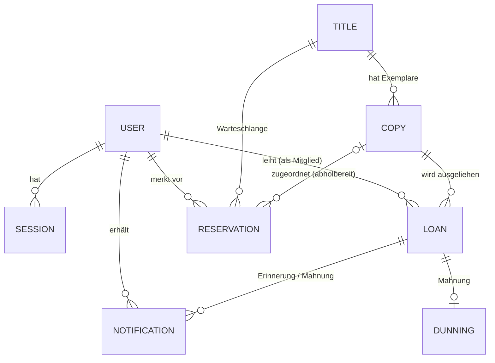

# Datenmodell (alle Epics E01–E07)

- Status: Vorgeschlagen (Gate 1)
- Bezug: Spezifikation 1.4 (Glossar), E01–E07, NFR03, NFR04, NFR06
- Code-Namen: [ADR 001](../adr/001-fachbegriffe-code-namen.md) · Datenbank: [ADR 002](../adr/002-persistenz-datenbank.md) · Status-Ableitung: [ADR 005](../adr/005-exemplarstatus-und-datenintegritaet.md) · Datum: [ADR 008](../adr/008-datum-und-zeitzone.md)

Das Modell deckt alle Epics ab, damit Woche 2 und 3 keine Umbauten brauchen. In Woche 1 (F-01 … F-07) werden nur die markierten Teile benutzt; die übrigen Tabellen dürfen trotzdem schon angelegt werden.

## Überblick

## Entitäten

Legende Spalte „Woche“: in welcher Woche die Entität zum ersten Mal fachlich gebraucht wird.

### `User` – Nutzer (Woche 1, Seed; Registrierung Woche 3)

| Feld | Typ | Pflicht | Regel / Quelle |
|---|---|---|---|
| `id` | UUID | ja | |
| `email` | Text | ja | eindeutig, klein geschrieben gespeichert (E06-US01-FR01) |
| `passwordHash` | Text | ja | nur Hash, nie Klartext (E06-US01-FR01, NFR03; Verfahren ADR 003) |
| `role` | `MITGLIED` \| `BIBLIOTHEKAR` \| `ADMINISTRATOR` | ja | E06-US02-FR01; siehe OF-D7 |
| `createdAt` | Zeitstempel | ja | |

Der **Gast** hat keinen Datensatz. Das **System** ist kein Nutzer, sondern ein Job mit Secret (ADR 007).

### `Session` – Anmeldesitzung (Woche 1)

| Feld | Typ | Pflicht | Regel |
|---|---|---|---|
| `id` | UUID | ja | |
| `userId` | → User | ja | |
| `tokenHash` | Text | ja | eindeutig; SHA-256 des Cookie-Tokens (ADR 003) |
| `expiresAt` | Zeitstempel | ja | Dauer: technische Konfiguration |
| `createdAt` | Zeitstempel | ja | |

### `Title` – Titel (Woche 1)

| Feld | Typ | Pflicht | Regel / Quelle |
|---|---|---|---|
| `id` | UUID | ja | |
| `title` | Text | ja | E02-US01-FR01 |
| `author` | Text | ja | E02-US01-FR01 |
| `category` | Text | ja | E02-US01-FR01; Form siehe OF-D5 |
| `isbn` | Text | nein | E02-US01-FR01 |
| `description` | Text | nein | E02-US01-FR01 |
| `publicationYear` | Ganzzahl | nein | **nicht** in E02-US01-FR01, aber Filter/Sortierung in E01-US01-FR02 → OF-D1 |
| `archivedAt` | Zeitstempel | nein | gesetzt = archiviert/deaktiviert (E02-US01-FR03) |
| `createdAt`, `updatedAt` | Zeitstempel | ja | |

### `Copy` – Exemplar (Woche 1)

| Feld | Typ | Pflicht | Regel / Quelle |
|---|---|---|---|
| `id` | UUID | ja | |
| `titleId` | → Title | ja | |
| `inventoryNumber` | Text | ja | eindeutig, vom System beim Anlegen vergeben (E02-US02-FR01); Format OF-D6 |
| `condition` | `GUT` \| `BESCHAEDIGT` \| `VERLOREN` | ja | E02-US02-FR02 („z. B.“) → OF-D3; `VERLOREN` ist nicht ausleihbar |
| `createdAt` | Zeitstempel | ja | |

Der **Status** (verfügbar / ausgeliehen / vorgemerkt / gesperrt) wird **nicht gespeichert**, sondern abgeleitet (ADR 005).

### `Loan` – Ausleihvorgang (Woche 1)

| Feld | Typ | Pflicht | Regel / Quelle |
|---|---|---|---|
| `id` | UUID | ja | |
| `copyId` | → Copy | ja | |
| `memberId` | → User | ja | |
| `startDate` | Datum | ja | E03-US01-FR01 |
| `dueDate` | Datum | ja | berechnet mit `leihfristTage` (E03-US01-FR01, FR02) |
| `renewalCount` | Ganzzahl ≥ 0 | ja | Start 0, höchstens `maxVerlaengerungen` (E03-US02-FR02) |
| `returnedAt` | Zeitstempel | nein | gesetzt = abgeschlossen (E03-US03-FR01) |
| `overdueSince` | Datum | nein | gesetzt vom System-Job (E04-US01-FR03, Woche 2) |
| `createdAt` | Zeitstempel | ja | |

Constraint **NFR06:** `UNIQUE (copyId) WHERE returnedAt IS NULL` (ADR 002).
„Offen“ heißt: `returnedAt IS NULL`.

### `Dunning` – Mahnung (Woche 2; in Woche 1 gelesen von F-05, geschrieben von F-07)

| Feld | Typ | Pflicht | Regel / Quelle |
|---|---|---|---|
| `id` | UUID | ja | |
| `loanId` | → Loan | ja | eindeutig: eine Mahnung je Ausleihvorgang (E04-US02-FR01, NFR04) |
| `createdOn` | Datum | ja | Datum der Mahnung (E04-US02-FR01) |
| `feeCents` | Ganzzahl | nein | Mahngebühr; endgültig festgehalten bei Rückgabe (E03-US03-FR02, E04-US02-FR02) |
| `settledAt` | Zeitstempel | nein | gesetzt = beglichen (E04-US02-FR03) |
| `settledById` | → User | nein | Bibliothekar, der beglichen markiert |

„Offene Mahnung“ heißt: `settledAt IS NULL`. Das betroffene Exemplar ergibt sich über `loanId`.
Ob eine Mahnung durch Verlängerung „gestoppt“ werden kann (E03-US02-FR03), ist offen → Spec F-06.

### `Reservation` – Vormerkung (Woche 2; in Woche 1 gelesen von F-02, F-03, F-06, F-07)

| Feld | Typ | Pflicht | Regel / Quelle |
|---|---|---|---|
| `id` | UUID | ja | |
| `titleId` | → Title | ja | Warteschlange je Titel (E05-US01-FR02) |
| `memberId` | → User | ja | |
| `createdAt` | Zeitstempel | ja | Reihenfolge der Warteschlange (E05-US01-FR02) |
| `status` | `WARTEND` \| `ABHOLBEREIT` \| `ABGEHOLT` \| `ABGELAUFEN` | ja | E05-US01-FR03 |
| `copyId` | → Copy | nein | gesetzt, sobald ein zurückgegebenes Exemplar zugeordnet ist (E03-US03-FR03) |
| `pickupDeadline` | Datum | nein | Ende der Abholfrist, `abholfristVormerkungTage` (E05-US01-FR03) |

„Aktive Vormerkung“ heißt: Status `WARTEND` oder `ABHOLBEREIT`. Ob eine Person ihre Vormerkung selbst zurückziehen kann (Status `STORNIERT`), sagt die Spezifikation nicht; das klärt die Spec F-10.

### `Notification` – Benachrichtigung (Woche 2)

| Feld | Typ | Pflicht | Regel / Quelle |
|---|---|---|---|
| `id` | UUID | ja | |
| `userId` | → User | ja | Empfänger |
| `type` | `ERINNERUNG` \| `MAHNUNG` \| `ABHOLBEREIT` | ja | E04-US01-FR02, E04-US02, E05-US01-FR03 |
| `loanId` | → Loan | nein | bei Erinnerung/Mahnung |
| `reservationId` | → Reservation | nein | bei Abholung |
| `dueDate` | Datum | nein | Fälligkeit, auf die sich eine Erinnerung bezieht (Idempotenz, ADR 007) |
| `createdAt` | Zeitstempel | ja | |
| `readAt` | Zeitstempel | nein | |

Kanal (Anzeige in der App oder E-Mail): OF-D8.

### `SystemSetting` – Systemparameter (Woche 3; in Woche 1 nur gelesen)

| Feld | Typ | Pflicht | Regel / Quelle |
|---|---|---|---|
| `key` | Text | ja | eindeutig; nur Namen aus `config/system.defaults.json` (ADR 006) |
| `value` | Zahl | ja | innerhalb `min`/`max` aus `config/` |
| `updatedAt` | Zeitstempel | ja | |
| `updatedById` | → User | ja | Administrator (E06-US02-FR02) |

### `JobRun` – Protokoll der System-Jobs (Woche 2)

| Feld | Typ | Pflicht | Regel |
|---|---|---|---|
| `id` | UUID | ja | |
| `job` | `FRISTPRUEFUNG` \| `ABHOLFRISTEN` | ja | ADR 007 |
| `stichtag` | Datum | ja | |
| `startedAt`, `finishedAt` | Zeitstempel | ja / nein | |
| `ergebnis` | JSON | nein | Anzahl Erinnerungen, Mahnungen, Abläufe, Fehler |

## Abgeleitete Werte (nicht gespeichert)

| Wert | Regel | Quelle |
|---|---|---|
| Exemplarstatus | siehe ADR 005 | E01-US02-FR01, E02-US02-FR03 |
| Anzahl verfügbarer Exemplare eines Titels | Exemplare mit Status `VERFUEGBAR` | E01-US01-FR03, E02-US02-FR03, E03-US01-FR04 |
| Offene Ausleihen eines Mitglieds | `Loan` mit `memberId` und `returnedAt IS NULL` | E03-US01-FR03, E03-US02-FR01 |
| Überschrittene Tage | `Rückgabedatum bzw. heute − dueDate` in Kalendertagen | E04-US02-FR02, ADR 008 |
| Mahngebühr (solange offen) | überschrittene Tage × `mahnTagessatzEuro` | E04-US02-FR02 |

## Offene Fragen zum Datenmodell (Gate 1)

| ID | Frage | Quelle | Vorschlag |
|---|---|---|---|
| OF-D1 | Erscheinungsjahr ist Filter- und Sortierkriterium (E01-US01-FR02), fehlt aber in den Feldern beim Anlegen (E02-US01-FR01). Soll es ein optionales Feld des Titels sein? | E01-US01-FR02, E02-US01-FR01 | optionales Feld `publicationYear`; Titel ohne Jahr stehen beim Sortieren am Ende |
| OF-D2 | Was heißt „gesperrt“ (E02-US02-FR03)? Nur `VERLOREN`, auch `BESCHAEDIGT`, oder eine eigene Sperre durch den Bibliothekar? | E02-US02-FR02, FR03 | gesperrt = Zustand `VERLOREN`; `BESCHAEDIGT` bleibt ausleihbar, solange das Team nichts anderes beschließt |
| OF-D3 | Welche Zustände gibt es genau? Die Spezifikation nennt „z. B. gut, beschädigt, verloren“. | E02-US02-FR02 | genau diese drei |
| OF-D4 | Was passiert mit archivierten Titeln? Im Katalog ausgeblendet? Exemplare noch ausleihbar? Wieder aktivierbar? | E02-US01-FR03 | im öffentlichen Katalog ausgeblendet, nicht ausleihbar, für Bibliothekare sichtbar |
| OF-D5 | Ist die Kategorie Freitext oder eine feste Liste? Wer pflegt die Liste? | E01-US01-FR02, E02-US01-FR01 | Freitext; Filter bietet die vorhandenen Werte an |
| OF-D6 | Format der Inventarnummer? | E02-US02-FR01 | fortlaufende Nummer mit Präfix, Format legt das Team fest |
| OF-D7 | Hat ein Nutzer genau eine Rolle? Dürfen Bibliothekar und Administrator auch selbst ausleihen? Hat der Administrator auch Bibliothekarsrechte? | 1.3, E06-US02-FR01 | genau eine Rolle; Rechte nur laut Rechte-Matrix, keine Vererbung |
| OF-D8 | Wie wird benachrichtigt (in der App, E-Mail)? | E04-US01-FR02, E05-US01-FR03 | Anzeige in der App (kein externer Dienst nötig); Entscheidung spätestens zur Spec F-08 |
