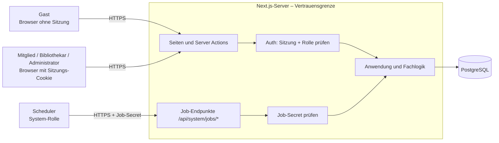

# Security-Architektur

- Status: Vorgeschlagen (Gate 1)
- Bezug: Spezifikation 1.3, E06-US01-FR01, E06-US01-FR02, NFR03, NFR04, NFR06
- Zugehörig: [Rechte-Matrix](rechte-matrix.md) · [ADR 003 Authentifizierung](../adr/003-authentifizierung-sitzungen.md) · [ADR 007 System-Jobs](../adr/007-system-jobs.md)

## 1. Schutzziele

| Schutzziel | Was konkret | Quelle |
|---|---|---|
| Vertraulichkeit | Mitglieder sehen nur eigene Ausleihvorgänge, Mahnungen, Vormerkungen; Gäste sehen keine Personendaten; Passwörter nur als Hash | 1.3, NFR03, `CLAUDE.md` |
| Integrität | Kein Exemplar in zwei offenen Ausleihvorgängen; Regeln (Limit, Mahnung, Verlängerung) nicht umgehbar | NFR06, E03-US01-FR03, E03-US02-FR02 |
| Verfügbarkeit / Zuverlässigkeit | Fristprüfung idempotent und wiederholbar | NFR04 |
| Nachvollziehbarkeit | Jeder Lauf der System-Jobs protokolliert | ADR 007 |

## 2. Akteure und Vertrauensgrenzen

Alles, was aus dem Browser oder vom Scheduler kommt, ist **nicht vertrauenswürdig**: Rolle, Nutzer-ID, Preise, Daten werden nie aus der Anfrage übernommen, sondern auf dem Server ermittelt.

## 3. Authentifizierung (E06-US01-FR01, NFR03)

- Anmeldung mit E-Mail und Passwort. Woche 1: nur Seed-Nutzer je Rolle (nur Entwicklung/Test). Woche 3 (F-11): Registrierung.
- Passwort-Hash: `scrypt` (`node:crypto`) mit zufälligem Salt je Passwort, Vergleich zeitkonstant (`timingSafeEqual`). Kostenparameter: technische Konfiguration.
- Fehlermeldung bei falscher Anmeldung verrät nicht, ob die E-Mail existiert.
- Sitzung: zufälliges Token im Cookie (`HttpOnly`, `Secure`, `SameSite=Lax`), in der DB nur SHA-256 des Tokens. Abmelden löscht die Sitzung.
- Passwörter, Hashes und Tokens erscheinen nie in Logs, Fehlermeldungen oder Antworten.

## 4. Autorisierung (E06-US01-FR02, Rechte-Matrix)

1. **Jede** Server Action, jeder Route Handler und jede geschützte Seite ruft auf dem Server `requireRole(...)` auf (ADR 003). Ausblenden von Buttons in der Oberfläche ist **kein** Schutz.
2. **Eigene Daten:** Abfragen für Mitglieder filtern immer mit `memberId = session.userId`. Eine ID aus der Anfrage (z. B. `loanId` beim Verlängern) wird nur zusammen mit diesem Filter verwendet. Fremde Datensätze ergeben `NICHT_GEFUNDEN` (verrät nicht, dass es sie gibt).
3. **Öffentliche Antworten** (Katalog, Detailseite) werden über eigene Lese-Modelle erzeugt, die keine Personendaten enthalten (nur Status und Fälligkeitsdatum).
4. **Default deny:** Neue Aktionen ohne Eintrag in der Rechte-Matrix sind verboten, bis Planning sie einträgt.

## 5. System-Jobs (NFR04)

- Endpunkte nur mit `Authorization: Bearer <JOB_SECRET>`; zeitkonstanter Vergleich; ohne Secret `401`.
- Eine Nutzer-Sitzung (auch Administrator) öffnet keinen Job-Endpunkt.
- Idempotenz über eindeutige Schlüssel (ADR 007). Jeder Lauf schreibt `job_runs`.
- `JOB_SECRET` liegt nur in der Umgebung des Hosters bzw. in GitHub Secrets, nie im Repo.

## 6. Eingaben, Formulare, Ausgaben

- Alle Eingaben werden auf dem Server validiert (Typ, Länge, Pflichtfelder laut Spec). Ungültig → `VALIDIERUNG` mit Feldangabe.
- Datenbankzugriff nur über das ORM bzw. parametrisierte Abfragen, keine zusammengesetzten SQL-Strings mit Eingaben (Freitextsuche F-01!).
- Server Actions: Next.js prüft die Herkunft (Origin) selbst. Route Handlers mit Schreibwirkung (nur Jobs) sind über das Secret geschützt.
- Ausgaben werden von React escaped; kein `dangerouslySetInnerHTML` mit Nutzerdaten (z. B. Beschreibung eines Titels).
- CSV-Export (F-13): Werte, die mit `=`, `+`, `-`, `@` beginnen, werden entschärft (CSV-Injection); enthält nur Bestandsdaten, keine Personendaten.

## 7. Datenintegrität (NFR06)

- Partieller eindeutiger Index `loans(copy_id) WHERE returned_at IS NULL` (ADR 002).
- Ausleihe und Rückgabe jeweils in einer Transaktion (ADR 005).
- Test: parallele Ausleihanfragen auf das letzte verfügbare Exemplar → genau ein Ausleihvorgang.

## 8. Secrets und Konfiguration

| Secret / Wert | Wo | Wer pflegt |
|---|---|---|
| `DATABASE_URL` (gehostet) | Umgebung des Hosters / GitHub Secrets | Konfigurationsrolle |
| `JOB_SECRET` | Umgebung des Hosters / GitHub Secrets | Konfigurationsrolle |
| Passwörter der Seed-Nutzer | beim Seeding erzeugt oder aus der Umgebung, nie im Repo | Konfigurationsrolle |
| Fachliche Parameter | `config/system.defaults.json` + `system_settings` | Konfigurationsrolle / Administrator |

Agenten lesen keine `.env`-Dateien (`.claude/settings.json`).

## 9. Bedrohungen und Gegenmaßnahmen

| Bedrohung | Beispiel | Gegenmaßnahme | Prüfung |
|---|---|---|---|
| Fremde Daten lesen (IDOR) | Mitglied ruft Verlängerung mit `loanId` von B auf | Filter `memberId = session.userId` | Security-Test Mitglied A/B |
| Rechteausweitung | Mitglied ruft Server Action „Titel anlegen“ direkt auf | `requireRole` in jeder Action | Security-Test je Rolle |
| Umgehen von Regeln | Ausleihe trotz Limit oder offener Mahnung per direktem Aufruf | Regeln im Server, nicht in der Oberfläche | Integrationstest F-05 |
| Doppelte Ausleihe | zwei gleichzeitige Klicks | Index + Transaktion | Paralleltest NFR06 |
| Passwort-Leak | DB-Dump | nur `scrypt`-Hash | Test: kein Klartext in `users` (NFR03) |
| Sitzungsdiebstahl | Token in Logs/JS | `HttpOnly`-Cookie, Token nur gehasht gespeichert | Review |
| Job missbrauchen | Fremder ruft Fristprüfung auf | Job-Secret | Security-Test System |
| Doppelte Mahnungen | Job läuft zweimal | eindeutige Schlüssel | Test NFR04 |
| SQL-Injection | Suchbegriff `' OR 1=1` | parametrisierte Abfragen | Test F-01 + CodeQL |
| XSS | Beschreibung mit `<script>` | React-Escaping | Review + CodeQL |
| CSV-Injection | Titel `=HYPERLINK(...)` | Entschärfen im Export | Test F-13 |
| Bekannte Lücken in Paketen | – | `npm audit`, Dependabot | CI-Job „Sicherheitslücken in Abhängigkeiten“ |
| Secrets im Repo | – | Secret Scanning, keine `.env` im Repo | GitHub Secret Scanning |

## 10. Aktive Prüfung durch Review & Security

Siehe `.claude/agents/review-security.md`. Ergebnisse werden im PR verlinkt (CI-Lauf, Code Scanning), nicht abgeschrieben.
